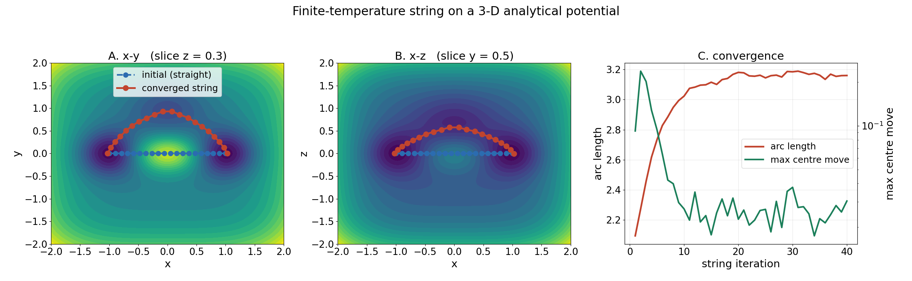
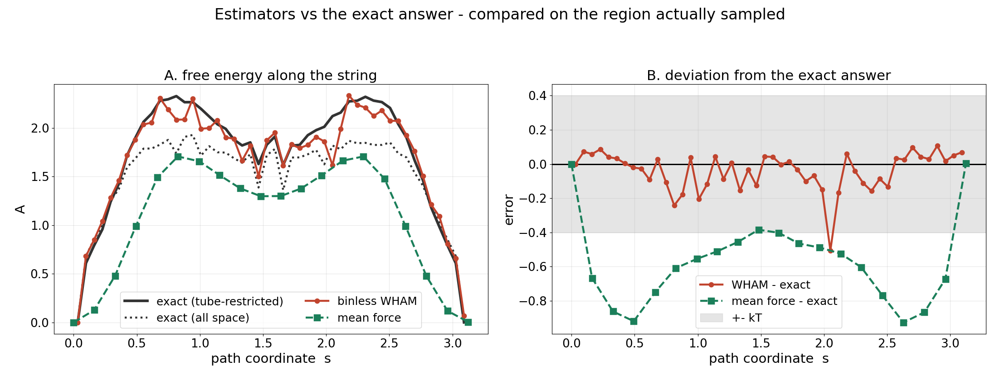
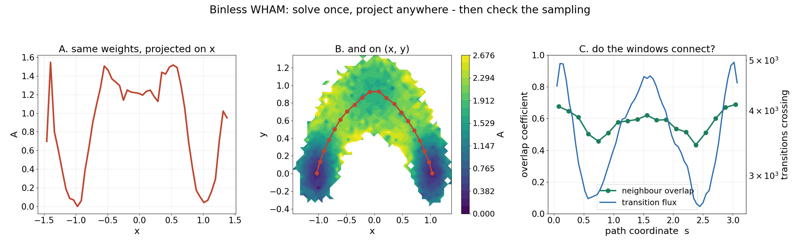
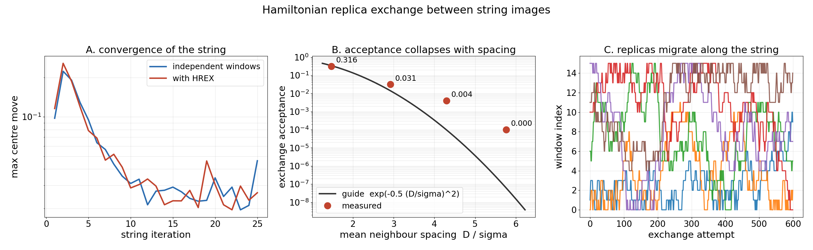
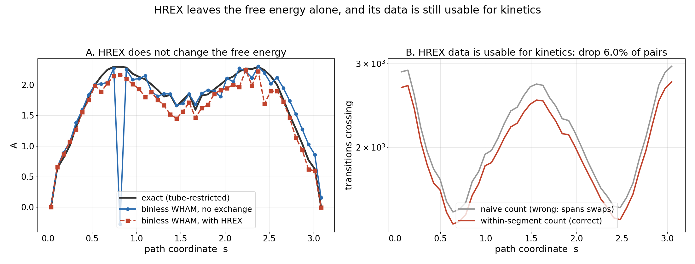

# Finite-temperature string method + binless WHAM, on a 3-D analytical system

A small, self-contained implementation of the string method we use for protein
free-energy pathways, demonstrated on a 3-D test potential whose exact free energy can
be computed and compared against.

The reparametrisation in `labstring.py` is the same code used for the finite-temperature
string calculations in [Rosta, Nowotny, Yang & Hummer, *J. Am. Chem. Soc.* **133**,
8934-8941 (2011)](https://doi.org/10.1021/ja200173a).

Only `numpy`, `scipy` and `matplotlib`. No MD engine, no PLUMED, no compilation.

```bash
python run_demo.py        # part 1: string + binless WHAM
python run_demo_hrex.py   # part 2: the same string with replica exchange
pytest                    # 20 tests
```

---

## What it produces

The string finds the curved minimum-free-energy path from a straight-line start. Left and
middle are slices through the potential (blue: initial guess, red: converged string);
right shows the arc length and the per-iteration centre movement.



Binless WHAM against the exact answer. On this run the barrier is 2.332 against an exact
tube-restricted 2.326.



One solve, three projections: the same per-sample weights give the free energy along the
path, along `x`, and on the `(x, y)` plane. The right panel is the sampling check.



---

## The test system

A sum of Gaussians plus a quartic confinement, with minima at `(-1, 0, 0)` and
`(+1, 0, 0)`. The straight line between them runs over a central ridge; the true path
arcs out through `+y` and `+z`. A string started on the straight line therefore has to
find the detour, and because the system is analytical the exact free energy along the
path is available by Boltzmann quadrature (`System.reference_pmf`).

`reference_pmf` takes an optional `tube_radius`. Use it: the restraints act on every CV,
so the windows sample a tube around the string, and an umbrella estimate should be
compared against a reference restricted to the same region.

---

## The method

**Umbrella windows.** Image *i* is restrained at centre `c_i`:

```
U_i(x) = sum_j  0.5 * k_j * (x_j - c_ij)^2
```

one harmonic term per collective variable.

**One iteration.**

```
for each image i:
    set the restraint centres to row i of the current string
    continue image i from its own end state of the previous iteration
    equilibrate (discard), then sample
when every image is done:
    reparametrise
```

**Reparametrisation (`labstring.py`)** - the lab `opt_string`, unchanged:

1. average each window's samples to one point per image
2. fit a cubic spline to each CV against image index
3. accumulate arc length on a grid of 10 points per image interval
4. place the new images at equal arc length, snapped to the nearest grid point
5. new centres = the spline at those grid points

Step 4 quantises placement to 1/10 of an image interval, so the straight-line **chord**
spacing of a reparametrised string is never exactly uniform even though the **spline arc
length** is. `labstring.spline_arc_spacing` checks the residual against that
quantisation.

---

## Binless WHAM (`reweight.py`)

Ordinary WHAM histograms first, then solves for one offset per window, so the bins are
fixed before the solve and a different coordinate means redoing everything.

Binless WHAM uses the reduced bias at every individual sample:

```
f_k  =  -ln  sum_n  exp(-u_k(x_n)) / sum_j N_j exp(f_j - u_j(x_n))        (1)

w_n  proportional to  1 / sum_j N_j exp(f_j - u_j(x_n))                   (2)

A(q) =  -kT ln sum_n w_n delta(q(x_n) - q)                                (3)
```

**Solve once, project anywhere.** After (1) and (2) you hold one weight per sample, and
the free energy along *any* coordinate is a weighted histogram - equation (3). Figure 3
shows the same weights projected three ways.

These are the MBAR equations; "binless WHAM" is the older name. Two solvers are provided,
and the tests assert they agree to 1e-5 kT:

* `solve_self_consistent` - equation (1) iterated literally. Read this one.
* `solve_lbfgs` - the same stationary point via the convex objective. Use this one.

Notes:

* Equation (1) is invariant under `f -> f + const`; we fix `f[0] = 0`.
* `u_k` must be reduced, i.e. `U_k / kT`.
* Every window must carry its own force constants and its own centre.
* Check `weight_diagnostics(weights)` before trusting a result. It reports the Kish
  effective sample size and the largest single weight; a reweighted PMF can look smooth
  while resting on very few frames.

**Mean force** (`mean_force_pmf`) integrates `dA/ds = k (c - <x>) . t` using only each
window's own average, so it needs no overlap between windows at all. Useful as an
independent check. It gives the free energy change *along the path*, which is not
identical to the projected PMF.

---

## Diagnostics (`diagnostics.py`)

| function | question | who needs it |
|---|---|---|
| `neighbour_overlap` | do adjacent windows share configurations? | WHAM, binless WHAM |
| `transition_flux` | do trajectories cross between them? | DHAM, MSMs |
| `predicted_gaussian_overlap` | can this `k` and spacing overlap at all? | design, before running |

These are different questions: one window crossing a region generates flux there even if
no *pair* of windows overlaps, and conversely. Report the minimum over boundaries, not
the mean.

---

## Part 2: Hamiltonian replica exchange (`hrex.py`)

```bash
python run_demo_hrex.py
```

Windows periodically swap configurations with their neighbours. Every window runs the
same unbiased potential and differs only in its restraint, so the acceptance needs only
the restraint energies:

```
Delta  =  [ U_i(x_j) + U_j(x_i) - U_i(x_i) - U_j(x_j) ] / kT
accept with probability min(1, exp(-Delta))
```

Neighbour pairs are swept in two alternating passes, so no window appears twice in one
pass:

```
parity 0 :  1-2, 3-4, 5-6, ...
parity 1 :  2-3, 4-5, 6-7, ...
```



**Free energies are unaffected** - detailed balance holds and every window keeps the
equilibrium distribution it had before. The demo checks this.

**Kinetics are still available.** An accepted exchange teleports a configuration between
windows, so a frame pair that straddles a swap did not evolve from one to the other. DHAM
and MSM estimators work on HREX data provided transition pairs are taken only within a
continuous segment. `transition_counts_continuous` enforces that; pass it the
`ExchangeStats` from the run and it drops a pair only where that window actually swapped,
which on the demo costs about 6% of pairs.



**Acceptance and spacing.** `predicted_acceptance` gives `exp(-(D/sigma)^2 / 2)` with
`sigma = sqrt(kT/k)`. Thinning the demo string by 1x, 2x, 3x and 4x gives:

| D / sigma | 1.47 | 2.92 | 4.30 | 5.77 |
|---|---|---|---|---|
| measured acceptance | 0.316 | 0.031 | 0.004 | 0.000 |

Force constants and window spacings are normally tuned together for this reason; the
point of the function is that the check is cheap and can be done before committing.

**What is swapped.** The configurations, with window identities fixed, so window *k*
always holds samples generated under bias *k*. Record samples per window, not per
replica, and the binless WHAM needs no change.

---

## Files

| file | contents |
|---|---|
| `potential3d.py` | the 3-D potential, analytic gradient, exact reference free energy |
| `labstring.py` | the lab reparametrisation, unchanged, plus an arc-spacing check |
| `sampler.py` | restrained overdamped Langevin; swap this for your MD engine |
| `fts.py` | the string iteration driver |
| `reweight.py` | binless WHAM (two solvers), projections, weight diagnostics, mean force |
| `diagnostics.py` | overlap and transition-flux diagnostics |
| `hrex.py` | replica exchange: the move, the sweep, segment-aware transition counts |
| `plumed_bridge.py` | write per-image `plumed.dat`, read COLVARs back |
| `run_demo.py` | part 1, end to end |
| `run_demo_hrex.py` | part 2, with replica exchange |
| `test_demo.py`, `test_hrex.py` | 20 tests |

---

## Adapting it to a real system

Replace `sampler.propagate` with a call to your MD engine, returning CV timeseries of
shape `(n_images, n_frames, n_cv)`. Everything else is dimension-agnostic and takes the
CVs as given - `labstring`, `reweight`, `diagnostics` and `hrex` never look at Cartesian
coordinates.

Carry over the protocol - continue each image from its own state, reparametrise only when
every image is done - and the habit of checking overlap, flux and weight health before
believing a barrier.

Every important coordinate should be in the string definition. A slow degree of freedom
left orthogonal to the path is invisible to the reparametrisation and to the reweighting.

---

## PLUMED

The demo does not need PLUMED - a toy potential and a short Langevin integrator keep the
tests fast. `plumed_bridge.py` is the bridge for a real system:

```bash
python plumed_bridge.py        # writes an example plumed.dat per image
```

```
restraint: RESTRAINT ...
   ARG=d1,d2,d3
   AT=0.270000,1.180000,1.130000
   KAPPA=2092.000000,2092.000000,2092.000000
...
PRINT ARG=d1,d2,d3 FILE=COLVAR STRIDE=100
```

```python
for iteration in range(n_iterations):
    write_plumed_inputs(outdir, cv_defs, centres, kappa, iteration)
    ...   launch n_images MD runs on your queue ...
    traj = read_colvars(outdir, n_cv, discard=n_equil)
    centres, info = labstring.reparametrize(traj)
```

PLUMED handles the CVs and the restraints; the reparametrisation and the reweighting stay
here. `read_colvars` raises if the images return different frame counts, which usually
means a run died.

PLUMED defaults to kJ/mol and nm - decide units once, and check `sqrt(kT/k)` against the
window widths you actually observe.

---

## Origin and references

> Rosta, E.; Nowotny, M.; Yang, W.; Hummer, G.
> **Catalytic mechanism of RNA backbone cleavage by ribonuclease H from quantum
> mechanics/molecular mechanics simulations.**
> *Journal of the American Chemical Society* **2011**, *133* (23), 8934-8941.
> DOI: [10.1021/ja200173a](https://doi.org/10.1021/ja200173a) ·
> PMID: [21539371](https://pubmed.ncbi.nlm.nih.gov/21539371/)

That study combined Hamiltonian replica exchange with a finite-temperature string method
to obtain the free-energy surface for RNA backbone cleavage by ribonuclease H. The
reparametrisation step in `labstring.py` is that same algorithm.

The reweighting implements the binless WHAM / MBAR equations:

> Shirts, M. R.; Chodera, J. D. **Statistically optimal analysis of samples from multiple
> equilibrium states.** *Journal of Chemical Physics* **2008**, *129*, 124105.
> DOI: [10.1063/1.2978177](https://doi.org/10.1063/1.2978177)

Related estimator work from the same group:

> Rosta, E.; Hummer, G. **Free energies from dynamic weighted histogram analysis using
> unbiased Markov state model.** *Journal of Chemical Theory and Computation* **2015**,
> *11* (1), 276-285. PMID: [26574225](https://pubmed.ncbi.nlm.nih.gov/26574225/)

> Stelzl, L. S.; Kells, A.; Rosta, E.; Hummer, G. **Dynamic histogram analysis to
> determine free energies and rates from biased simulations.** *Journal of Chemical
> Theory and Computation* **2017**. PMID:
> [29059525](https://pubmed.ncbi.nlm.nih.gov/29059525/)
